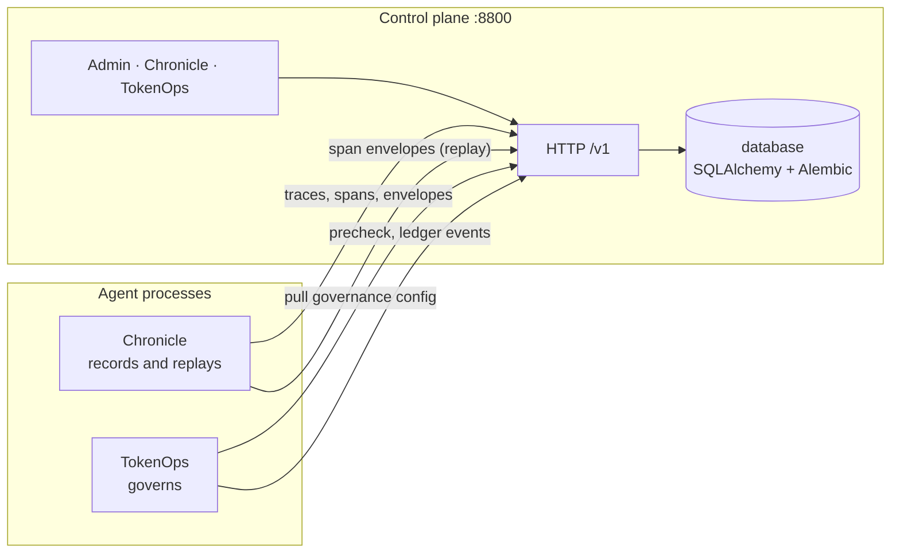

<div align="center">

# AgentPlane Control

**The shared control plane for agent traces and spend.**<br>
<sub>Stores what Chronicle records, serves it back for query, visualization and replay, and holds the governance TokenOps enforces.</sub>

[](https://github.com/theagentplane/control-plane/actions/workflows/ci.yml)
[](https://pypi.org/project/agentplane-control-plane/)
[](https://github.com/theagentplane/control-plane)
[](LICENSE)
[](https://peps.python.org/pep-0561/)

<br>

[Why](#why) · [How it fits](#how-it-fits) · [Install](#install) · [Quick start](#quick-start) · [API](#api) · [Database](#database) · [Configuration](#configuration) · [Development](#development)

</div>

## Why

- **One service, one database.** Chronicle and TokenOps are HTTP clients. Agents and browsers never
  receive a database path or a connection string.
- **The shared schema.** Traces, spans and envelopes are the
  [`agentplane-primitives`](https://github.com/theagentplane/primitives) entities, validated with
  the same models Chronicle builds them with.
- **A run is a trace.** There is one identifier, `trace_id`. TokenOps governance (budgets, the
  ledger, halts) is keyed by it; there is no second run table.
- **Not tied to SQLite.** The database is one SQLAlchemy URL and the schema is owned by Alembic.
- **Auth when you need it.** With no keys the service is open for the `local` tenant; with keys,
  every request is tenant-scoped and scope-checked.

## How it fits



| Piece | Owns | Does not own |
|---|---|---|
| **This service** | The database, the HTTP API, the web page, migrations | Agent loops, LLM calls, record-and-replay logic |
| **[Chronicle](https://github.com/theagentplane/chronicle)** | Boundaries, envelopes, replay | The database |
| **[TokenOps](https://github.com/theagentplane/tokenops)** | Governors and the in-path decisions | The database |

## Install

```bash
pip install agentplane-control-plane
```

Python 3.10 to 3.13. The sidecars are separate packages (`agent-chronicle>=1.0`).

## Quick start

```bash
control-plane serve                      # http://127.0.0.1:8800, SQLite file in the working directory
control-plane start | status | stop      # the same, as a background instance
```

The first start creates the schema (Alembic) and seeds the default governance configuration for
tenant `local`. Point Chronicle at it:

```python
import chronicle

chronicle.configure(control_plane_url="http://127.0.0.1:8800", api_key="...")
```

Open `http://127.0.0.1:8800/` for the Admin, Chronicle and TokenOps tabs.

## API

Full reference: [docs/chronicle-api.md](docs/chronicle-api.md) and
[docs/governance-api.md](docs/governance-api.md). Interactive docs are served at `/docs`.

| Group | Routes |
|---|---|
| **Chronicle** (primitives) | `POST /v1/traces` · `PUT /v1/traces/{t}/spans/{s}` · `POST /v1/envelopes:batch` · `GET /v1/traces` · `GET /v1/traces/{t}` · `GET /v1/traces/{t}/envelopes` · `GET /v1/traces/{t}/spans/{s}/envelopes` |
| **Governance** (the pull) | `GET /v1/governance/{agent}` (ETag) · CRUD on `/v1/segments`, `/v1/budgets`, `/v1/policies` |
| **Ledger** | `POST /v1/ledger/precheck` · `POST /v1/ledger/events:batch` · `GET /v1/ledger/traces` · halt routes on `/v1/ledger/traces/{t}/halt` |
| **Admin** | `/v1/admin/keys` · `POST /v1/admin/governance/reseed` and `/clear` |
| **Probes** | `GET /health` · `GET /ready` |

## Database

The database is selected by one SQLAlchemy URL, `CONTROL_PLANE_DATABASE_URL`
(default `sqlite:///control_plane.db`). The code uses SQLAlchemy Core only and no dialect-specific
SQL outside the engine factory, so it is not bound to one engine. SQLite is what the test suite
runs on; other databases need their own driver installed.

The schema is owned by **Alembic**; the migrations ship inside the package:

```bash
control-plane db upgrade             # apply migrations (also done at startup, CONTROL_PLANE_AUTO_MIGRATE)
control-plane db current             # the revision the database is at
control-plane db seed [--file F] [--tenant T] [--reset]   # governance config from YAML
control-plane db prune --older-than-days 30               # retention; nothing runs in the background
```

## Configuration

| Variable | Default | Meaning |
|---|---|---|
| `CONTROL_PLANE_DATABASE_URL` | `sqlite:///control_plane.db` | SQLAlchemy URL of the database |
| `CONTROL_PLANE_AUTO_MIGRATE` | `true` | Run `alembic upgrade head` at startup |
| `CONTROL_PLANE_SEED_ON_START` | `true` | Seed the default governance config for tenant `local` if it has none |
| `CONTROL_PLANE_API_KEYS` | empty | `key:tenant:scope+scope,...` (scopes: `ingest`, `read`, `admin`) |
| `CONTROL_PLANE_MAX_BATCH` | `100` | Largest `envelopes:batch` or `events:batch` |
| `CONTROL_PLANE_MAX_BODY` | `4194304` | Largest request body in bytes |
| `CONTROL_PLANE_RETENTION_DAYS` | none | Default age for `db prune` |

## Development

Uses [uv](https://docs.astral.sh/uv/). On Windows use `python -m pytest`.

```bash
uv sync
uv run python -m pytest --cov
uv run ruff check . && uv run ruff format --check .
uv run python -m mypy
uv build && uv run twine check dist/*
```

Architecture decisions are in [docs/adr](docs/adr/README.md); agents working in this repository
read [AGENTS.md](AGENTS.md) first.

## Related

[chronicle](https://github.com/theagentplane/chronicle) ·
[primitives](https://github.com/theagentplane/primitives) ·
[tokenops](https://github.com/theagentplane/tokenops)
